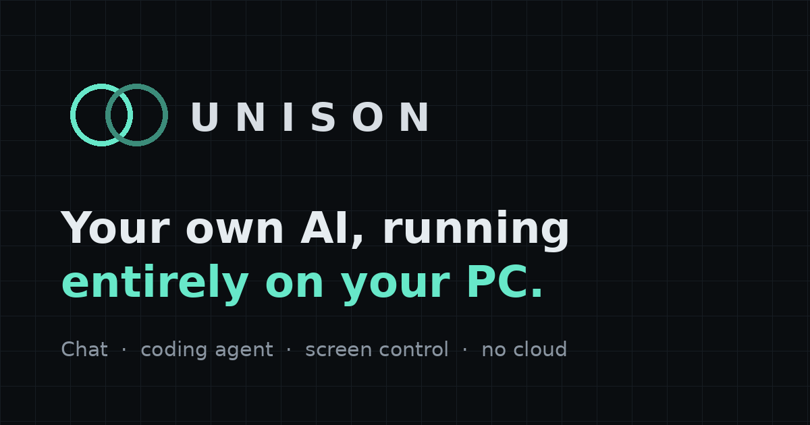

<p align="center"></p>

<p align="center">
  <a href="https://softwareglitching.github.io/unison-site/downloads/UNISON.zip"><b>⤓ Download for Windows</b></a> ·
  <a href="https://softwareglitching.github.io/unison-site/chat.html">Chat in your browser</a> ·
  <a href="https://softwareglitching.github.io/unison-site/">Website</a> ·
  <a href="#start-here">Install guide</a>
</p>

# UNISON

A private AI that runs on your own Windows PC. UNISON is the platform — runtime, API, web app, memory,
tools, screen control and training — wrapped around an open-weight model that runs locally through
Ollama. No cloud APIs, no API keys needed to chat, no telemetry.

**Current build: v0.7 — a much smarter brain (UNISON's own `unison` model, Upgrade-Brain.bat), a redesigned app, 2-step sign-in for remote access, licensed-only setup; v0.6.1 — the browser chat can use your PC's full model through the public link; v0.6 — license keys, a browser chat for phones, a public link for using UNISON from any
browser (e.g. at work), and stronger remote-access protection.** Earlier: v0.5 sign-in + download site,
v0.4 jobs + remote access, v0.3 screen control.

## Two ways to use UNISON

| | Browser chat | Windows app |
|---|---|---|
| Where | Any phone, tablet or computer — [open it](https://softwareglitching.github.io/unison-site/chat.html) | Your own Windows PC — [download](https://softwareglitching.github.io/unison-site/downloads/UNISON.zip) |
| AI | A compact model that runs inside your browser | Bigger, smarter models on your own GPU |
| Can do | Chat, personalities, code help | Chat, coding agent (files + terminal), screen control, knowledge base, MCP tools, background jobs, remote access |
| Needs | A browser with WebGPU (Chrome, Edge, Safari 17+) | Windows 10/11, ideally an NVIDIA GPU |
| Unlock | Your license key | The same license key |

Nothing you type is sent to a server in either version.

**Use your PC's full model from the website:** on the PC, run `Enable-Remote.bat` and choose
**2) Public link**. Then in the browser chat open **Choose brain → UNISON PC** and paste the link it
printed (`https://….ts.net`). Your license key signs you in, and the chat runs on the PC's big model,
even on phones without WebGPU. Website visitors can only chat: no files, tools, screen control, jobs or
settings, and requests are rate-limited.

## License keys

UNISON needs a license key. **One key unlocks both the browser chat and the Windows app.**

- **Browser chat:** open the chat, paste your key, tap **Unlock**. It's remembered on that device
  (⚙ Settings → License → *Remove key from this device* to sign out).
- **Windows app:** the first time UNISON starts it shows an activation screen — paste your key there.
- **PC-locked keys:** some keys only work on one computer. The activation screen shows your
  **Machine ID** — send it when you buy and your key will be made for that PC.
- Keys can expire (trials). An expired key stops working on its own; you'll be asked for a new one.

Get a key from the [website](https://softwareglitching.github.io/unison-site/#license).

## Use UNISON from work (any browser)

Run `Enable-Remote.bat` and choose **2) Public link**. You get an `https://….ts.net` address that opens in
any browser — no install on the work computer. It requires a strong UNISON password (12+ characters);
wrong passwords lock that address out for 15 minutes, and passwords can only be created or replaced at the
PC itself. Chat, rate answers to train it, run jobs and approve steps from there. Turn it off with
`Enable-Remote.bat -Off`. Your PC must be on, awake and running UNISON.

## Sign-in (v0.5)

Set a password in **Settings → PC access → Sign-in password** (or `Set-Password.bat`). From then on every
device — this PC included — signs in once and stays signed in for 30 days. `Enable-Remote.bat` won't open
remote access until a password exists. Changing the password signs out every other device. Forgot it? On
the PC run `scripts\password.bat set` (or `scripts\password.bat clear`). The password is stored only as a
PBKDF2 hash; login attempts are rate-limited.

## Working while you're away (v0.4)

**Jobs** (button at the top): give UNISON a task — files + terminal, or screen — and it keeps working
after you close the page, one job at a time. Progress, results and a final summary are saved, so you can
check from anywhere.

- **Supervised job:** pauses on each risky step and waits (up to 8 hours) until you approve it — from your
  phone if you like. The top bar shows "jobs (1 waiting)".
- **Autonomous job:** approves its own steps. Dangerous commands stay blocked, every file change is
  backed up, and jobs stop after 60 steps.
- **Autonomous switch** (Settings → PC access) does the same for normal agent chats.
- File/terminal jobs work while Windows is locked. Screen jobs need the PC awake **and unlocked**.

**Remote access from your phone or work:** double-click **`Enable-Remote.bat`**. It uses Tailscale (free
for personal use) to put UNISON on a private, encrypted network that only your own signed-in devices can
reach — no open ports, nothing public. It locks remote use to your Tailscale account, can stop the PC
from sleeping on AC power, and can start UNISON at sign-in. Then install Tailscale on your phone, sign in
with the same account, and open the `https://...ts.net` address it prints. Turn it off with
`Enable-Remote.bat -Off`.

## Low on space on C:?

Ollama stores every model in `C:\Users\<you>\.ollama\models` (5–20 GB). Double-click
**`Move-Models.bat`**: it stops Ollama, moves the models to another drive (D: by default), points Ollama
there permanently (`OLLAMA_MODELS`) and restarts it. Nothing is downloaded again. The UNISON folder
itself is small apart from `.venv` and `frontend\node_modules`; you can move the whole folder to D: too,
then run `Update.bat` once from the new place and recreate the desktop shortcut.

## Screen control (screen mode)

A local vision model (`qwen3-vl`, picked for your GPU by Update.bat) looks at a screenshot, decides one
action — click, double-click, right-click, drag, scroll, type, key shortcut, open an app — does it, looks
again, and repeats until it's done (max 40 actions).

- **Ask mode** (default): every action waits for Approve/Deny with a screenshot marked where it will click.
- **Autopilot**: no questions; the UNISON window minimises itself while it works.
- **Stop any time:** press **Esc**, or shove the mouse into the **top-left corner**, or click stop.
- It can't click or type into UNISON's own window (so it can't approve itself), and it refuses to type
  text that matches the dangerous-command blocklist. It's told not to type passwords or payment details.
- Honest expectations: an 8B vision model handles simple, visible tasks (open an app, type, click obvious
  buttons, fill a simple form) and gets lost on long multi-app jobs. Bigger vision models (`qwen3-vl:30b`)
  do better if you have the VRAM. For programming, agent mode (files + terminal) is far more reliable.

## Updating from an earlier version

1. Close UNISON's server window.
2. Extract the new zip **over your existing UNISON folder** and let it replace files. Your chats
   (`data\`), settings (`config\unison.json`), installed packages and models are not in the zip, so they stay.
3. Double-click **`Update.bat`**. It installs the new packages, rebuilds the app, downloads the small
   embedding model (`nomic-embed-text`, ~0.3 GB), indexes the programming notes, asks where UNISON may
   work (a "UNISON Projects" folder on your Desktop is recommended) and runs the self-test with your model.

## What UNISON can do on your PC

With **agent mode** on (the toggle under the message box), UNISON can:

- read your project folders: list, find, search and read files;
- create and edit files — every change shows a diff and waits for your **Approve / Deny**;
- run terminal commands (python, node, npm, git, dotnet…) and read the output to fix its own mistakes —
  read-only commands like `git status` run straight away, anything else asks first, and dangerous
  commands (formatting drives, registry edits, disabling security, piping downloads into a shell…) are
  always blocked;
- open files/folders with their default app;
- use extra tools from MCP servers (Settings → MCP), each asking for approval by default;
- look things up in its knowledge base.

It can only touch **workspace folders** you approve (Settings → PC access). Credentials (`.env`, keys,
`.ssh`) and UNISON's own files are always off-limits. Every changed or deleted file is backed up first and
can be restored from Settings → PC access. Everything it does is logged to `logs\audit.log`.

What it can't do: click around your screen or other apps (e.g. inside Roblox Studio). For Roblox it writes
Luau files — ideally a Rojo project — that you sync into Studio.

## Making UNISON smarter at programming

There are three different levers. They are measured, not assumed:

| Lever | What it changes | How |
|---|---|---|
| A bigger model | General reasoning and coding ability | Model menu → a higher tier your hardware supports |
| Knowledge base (RAG) | What it can look up while answering: the programming notes in `knowledge\curated`, your notes, and your own project code | Settings → Knowledge → index; `scripts\index_knowledge.bat <folder>` |
| Fine-tuning (LoRA) | The model's weights — its habits and style | Rate replies 👍/👎, write corrections, export the dataset (Settings → Training). Training adapters is the next step |

**Measure:** `scripts\eval.bat` runs 24 programming tasks — Python and JavaScript code is executed
against tests, Roblox/Blender answers are checked for the right APIs, and agent tasks make the model
create, run, debug and explore real files in a throwaway folder. Results appear in Settings → Training.
Run it with and without the knowledge base (`--no-knowledge`) and before/after any change.

---

## Start here

1. [Download UNISON.zip](https://softwareglitching.github.io/unison-site/downloads/UNISON.zip) and unzip it somewhere with space, e.g. `C:\UNISON` (avoid OneDrive-synced folders: the
   `node_modules` and `.venv` folders hold thousands of files).
2. Double-click **`Setup.bat`**. The **UNISON Setup** window opens: paste your license key and
   click **Install**. It then, showing each step as it goes:
   - inspects your hardware (Windows version, CPU, RAM, GPU + VRAM, CUDA, disk, installed tools)
     and writes `docs\HARDWARE_REPORT.md`;
   - installs anything missing — Python 3.12, Node.js LTS, Ollama — via `winget`;
   - picks the model recommended for *your* hardware and downloads it (one time; 1–19 GB);
   - installs the backend into `.venv`, builds the app;
   - runs a self-test that chats with the real model, writing the actual replies to `docs\SELFTEST.md`.
   (Prefer the old text version, with a choice of model? Run `Setup.bat -Text`.)
3. Click **Finish**. UNISON is added to the Start menu and your desktop, and opens in its own window.
   From then on just open **UNISON** from the Start menu (or double-click `Start-UNISON.bat`).
   There's no black console window: UNISON lives in the **tray by the clock**. Closing the window
   keeps it ready in the tray; right-click the tray icon to **Quit**, turn on remote access, restart it,
   or make it start with Windows.

The first message after starting takes longer while the model loads into memory. After that,
replies stream at whatever speed your hardware delivers — the real tokens/second is shown in the
telemetry bar and under every reply.

## Model configurations

Setup picks three from this catalog (all Apache-2.0, all coding-focused, all run by Ollama):

| Model | Size | Notes |
|---|---|---|
| `qwen2.5-coder:1.5b` | 1.0 GB | Very fast, basic answers |
| `qwen2.5-coder:7b` | 4.7 GB | Strong coder for 8 GB GPUs |
| `qwen2.5-coder:14b` | 9.0 GB | Better reasoning and multi-file code |
| `devstral:24b` | 14 GB | Agentic coding model, 16 GB+ GPUs |
| `qwen3-coder:30b` | 19 GB | Mixture-of-experts (3B active), usable split across GPU + RAM |

The rules live in `backend/core/model_selection.py`: *balanced* is the best model that fits
entirely in your VRAM, *advanced* is the strongest that still runs at a usable speed (allowing a
GPU+RAM split), *lightweight* is one step smaller. Without a supported GPU everything runs on CPU.
Qwen2.5-Coder **3B** is deliberately excluded because it uses a non-commercial license.

Switch or download models any time from the model menu in the top-right of the app. Any other
model you `ollama pull` yourself also appears there.

## Using the API

Interactive docs: **http://127.0.0.1:8770/docs**

OpenAI-compatible — point existing tools at UNISON by changing the base URL:

```python
from openai import OpenAI   # pip install openai  (the client library only; nothing goes to OpenAI)
client = OpenAI(base_url="http://127.0.0.1:8770/v1", api_key="local")
r = client.chat.completions.create(model="unison", messages=[{"role": "user", "content": "Hello"}])
print(r.choices[0].message.content)
```

```bash
curl http://127.0.0.1:8770/v1/chat/completions -H "Content-Type: application/json" ^
  -d "{\"messages\":[{\"role\":\"user\",\"content\":\"Write a Luau for-loop\"}],\"stream\":false}"
```

`model: "unison"` (or omitted) means "the active model".

| Endpoint | Purpose |
|---|---|
| `POST /v1/chat/completions` | OpenAI-format chat, streaming (SSE) or not, stateless |
| `POST /v1/chat` | UNISON chat with stored conversations (`conversation_id`, `regenerate`) |
| `GET /v1/models` | Installed models, active model, foundation-model details |
| `GET /v1/models/recommended` | The three tiers chosen for your hardware |
| `POST /v1/models/active` · `POST /v1/models/pull` · `DELETE /v1/models/{name}` | Model management (this PC only) |
| `GET /v1/health` | Engine status, active model installed? |
| `GET /v1/system/metrics` | Real CPU/RAM, GPU via nvidia-smi, tok/s, how much of the model is in VRAM |
| `GET/PATCH /v1/settings/inference` | Temperature, top-p, top-k, repeat penalty, context length |
| `GET/PATCH/DELETE /v1/conversations[/{id}]` | Conversation history and search |
| `GET/POST/DELETE /v1/keys` | API key management (this PC only) |
| `POST /v1/chat` with `"tools": true` | Agent mode; streams `tool_call`, `approval_required`, `tool_result` events |
| `GET /v1/approvals` · `POST /v1/approvals/{id}` | Pending agent actions; approve or deny (this PC only) |
| `GET /v1/tools` · `PATCH /v1/tools/{name}` · `POST /v1/tools/execute` | Tools, permission modes, direct execution (`approved: true` needed for "ask" tools) |
| `GET/POST /v1/workspaces` · `GET /v1/backups` · `POST /v1/backups/{id}/restore` | Allowed folders and undo |
| `GET/POST/DELETE /v1/mcp/servers` | MCP servers (stdio) |
| `GET /v1/knowledge` · `POST /v1/knowledge/index` · `/search` · `/documents` | Knowledge base |
| `POST /v1/feedback` · `GET /v1/training` · `POST /v1/training/export` | Ratings, benchmark results, datasets |

`/v1/chat/completions` also accepts OpenAI-style `tools`: the model's tool calls come back as
`tool_calls` for *your* program to run (standard OpenAI behaviour). Memory and project endpoints arrive
with the phases that implement them; nothing is stubbed with fake data.

## Security model

- UNISON listens on `127.0.0.1` only. Nothing else on your network can reach it.
- API keys: `scripts\apikey.bat create "My app"`. Only a SHA-256 hash is stored; the key is shown once.
- To expose UNISON to other devices, edit `config\unison.json`: set `server.host`, set
  `auth.require_api_key` to `true`, and give `server.ssl_certfile` / `ssl_keyfile`. The server
  **refuses to start** on a non-local address without all three.
- Requests are rate-limited (`rate_limit.requests_per_minute`) and logged to `logs\requests.log`
  without message contents or keys.
- All data lives in this folder: `data\unison.db` (SQLite), `config\`, `logs\`. Models live in
  Ollama's folder (`%USERPROFILE%\.ollama\models`).

## Configuration

`config\unison.default.json` holds defaults; your changes go to `config\unison.json` (setup and
the app write it). Environment overrides are listed in `.env.example`. The system prompt is
`assistant.system_prompt`; `{model}` is replaced with the foundation model's name.

## Troubleshooting

| Problem | Fix |
|---|---|
| Red "engine offline" | Open **Ollama** from the Start menu, then reload the page. |
| "Model isn't downloaded" | Model menu → download, or `ollama pull <name>` in a terminal. |
| Very slow replies | Telemetry shows "model mem … % GPU". Under 100% means part of the model is on CPU: pick a smaller tier, or lower the context length in ⚙. |
| Setup failed at a step | Read the message; full log in `logs\setup.log`. Fix and run `Setup.bat` again — it skips finished steps. |
| Port 8770 busy | Set `server.port` in `config\unison.json`. |


## Project layout

```
UNISON/
  Setup.bat, Update.bat, Start-UNISON.bat     double-click entry points
  UNISON.exe                                 the Windows app (built from desktop\ during setup)
  backend/
    api/          FastAPI routes + request schemas
    core/         config, chat/agent service, hardware-aware model selection, system metrics
    agents/       agent prompts, approval broker
    tools/        workspace sandbox, file and terminal tools, permission registry + audit log
    mcp/          MCP stdio client and server manager
    knowledge/    chunking, local embeddings, vector search, knowledge tool
    training/     benchmark runner, dataset export
    inference/    unified model interface (base.py), Ollama backend, model manager
    database/     SQLite storage
    security/     API keys, auth, rate limiting, request logging
    main.py, run.py
  frontend/       React + TypeScript + Vite web app
  config/         settings, hardware.json, models.json (generated)
  scripts/        setup, update, start, hardware inspection, self-test, eval, indexing, dataset export, API keys
  tests/          automated tests
  docs/           DEVLOG.md, HARDWARE_REPORT.md, SELFTEST.md (generated)
  knowledge/      curated notes + your notes (indexed into data\knowledge.db)
  datasets/       eval/benchmark.jsonl, eval/results/, training/ exports
  projects/       default workspace until you choose another
```

## Roadmap

- **Phase 1 — working local AI** ✅
- **Phase 2 — initial intelligence:** ✅ local embeddings, knowledge base + retrieval, curated
  programming/Roblox/Blender/AI notes, project indexing, benchmark. ⏳ long-term memory you control.
- **Phase 3 — MCP & tools:** ✅ built-in file/terminal tools, MCP stdio client, permissions, approvals, audit log.
- **Phase 4 — programming agent:** ✅ multi-step agent loop with diffs, backups, test running, loop guards.
  ⏳ dedicated coding workspace view.
- **Phase 5 — Blender:** scene generation via Blender's Python API, renders, exports.
- **Phase 6 — platform:** ✅ feedback → datasets, benchmark history. ⏳ LoRA/QLoRA training of adapters
  (needs your GPU details), specialised agents, model analytics.

Retrieval (RAG) and fine-tuning are kept separate: adding documents makes knowledge *available*
to the model at answer time; it does not change the model's weights.

## Licenses

UNISON is proprietary software © 2026 PerkyPop — see `LICENSE` in the download. Using it requires a license key.
Model weights keep their own licenses (listed in `config\models.json` and the hardware report);
UNISON downloads them on your PC rather than shipping them. Ollama is MIT-licensed.
